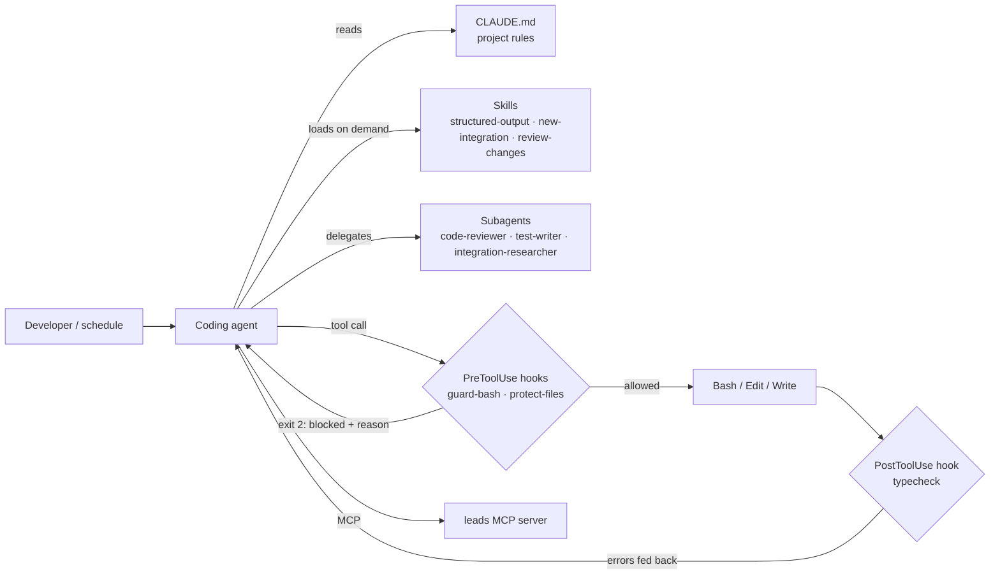
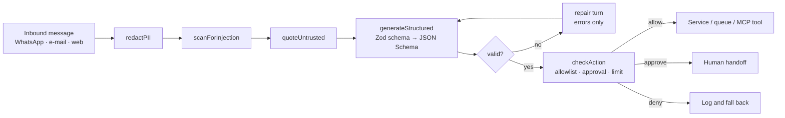

# Architecture

The repository has two halves that share the same principles.

1. **Development harness** (`.claude/`, `CLAUDE.md`, `.mcp.json`): how a
   coding agent is set up to work on a codebase safely and predictably.
2. **Runtime building blocks** (`src/`): how LLM features are put into a
   product so their output can be trusted by other services.

## Development harness

- **Context is layered.** `CLAUDE.md` stays short and always loaded; longer
  procedures live in skills, which load only when the task calls for them.
  That keeps the base prompt small on every turn.
- **Checks are enforced, not requested.** Rules that matter (no force push,
  no secrets in the transcript, no edits to generated files, types must
  compile) are hooks, so they hold even when the instructions are ignored.
  A blocked call returns the reason, so the agent corrects course.
- **The author does not grade its own work.** Review runs in a subagent with
  its own context, which has not seen the reasoning behind the change.
- **Permissions are explicit.** Read-only tools are pre-approved; writes to
  shared state (`git push`, `move_lead_stage`) always ask.
- **Same harness, unattended.** The scheduled workflow runs the agent
  headless with a narrow tool allowlist and turns the result into an issue.

## Runtime: from untrusted text to a safe action

- **Structured output is the contract.** The model returns JSON that
  validates against a schema derived from the same Zod type the code uses.
  Downstream code consumes a typed object, the same way it would consume an
  internal API.
- **Repair instead of retry.** On a validation failure only the errors are
  sent back, which is far shorter than repeating the original prompt.
- **The model proposes, the policy decides.** Every side effect passes an
  allowlist, an approval list and a per-run limit.

## Native integrations

`HttpClient` covers what low-code connectors usually hide: per-host token
bucket rate limiting, timeouts, retries with exponential backoff and jitter
on retryable failures only, `Retry-After`, TTL cache for reads and a
deterministic idempotency key on writes, so a retried request is never
applied twice. Time, randomness and `fetch` are injected, so every one of
those behaviours is covered by fast, deterministic tests.

## MCP server

`src/mcp/` exposes a lead funnel over the Model Context Protocol. Each tool
declares input and output schemas and returns `structuredContent`; read
tools carry `readOnlyHint`; stored text is screened for injection before it
is returned, because tool output is a common injection path.
